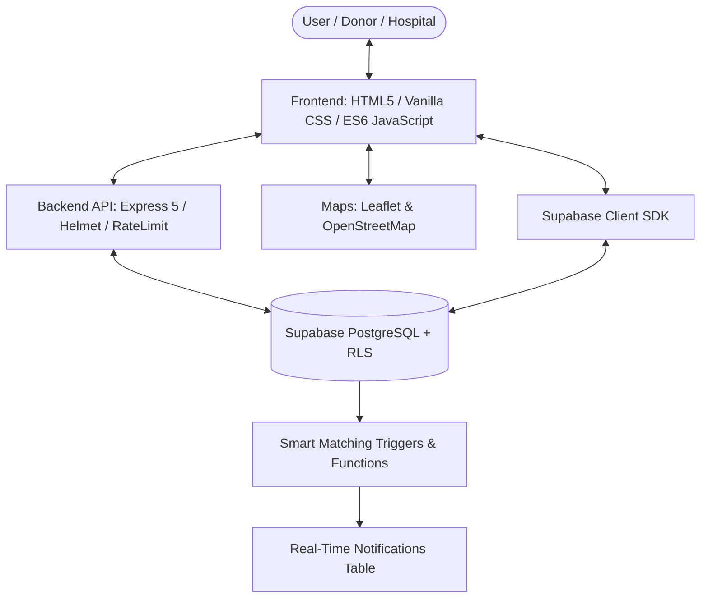

# 🩸 Blood Bridge — Emergency Blood Donation & Smart Matching Platform

<p align="center">
  
</p>

<p align="center">
  <b>A real-time, life-saving blood donation ecosystem connecting emergency patients, voluntary donors, and hospitals.</b>
</p>

<p align="center">
  
  
  
  
  
</p>

---

## 📖 Table of Contents

- [Overview](#-overview)
- [Key Features](#-key-features)
- [System Architecture](#-system-architecture)
- [Project Structure](#-project-structure)
- [Getting Started](#-getting-started)
  - [Prerequisites](#prerequisites)
  - [Environment Variables](#environment-variables)
  - [Database Setup](#database-setup)
  - [Running Locally](#running-locally)
- [Core Workflows](#-core-workflows)
  - [Smart Matching & Real-Time Alerts](#1-smart-matching--real-time-alerts)
  - [3-Month Cooling Period Enforcement](#2-3-month-cooling-period-enforcement)
  - [Gamification & "Your Impact"](#3-gamification--your-impact)
- [API Reference](#-api-reference)
- [Security & Compliance](#-security--compliance)
- [License](#-license)

---

## 🌟 Overview

**Blood Bridge** is an emergency medical platform designed to eliminate delays in finding compatible blood donors during critical moments. By combining **geospatial search (100 km radius)**, **automated blood compatibility matching**, and an **instant notification pipeline**, Blood Bridge ensures that urgent blood requests reach available, eligible donors immediately.

---

## 🚀 Key Features

### 🩸 Smart Blood Matching System
- **Compatibility Engine**: Matches blood requests according to universal transfusion compatibility rules (e.g., $O^-$ universal donor, $AB^+$ universal receiver).
- **Automated Alerts**: When an emergency blood request is submitted, a Postgres trigger automatically locates matching available donors within the region and sends real-time in-app notifications.

### 📍 Interactive Leaflet Maps & 100 KM Radius Filtering
- Live OpenStreetMap integration with **Haversine formula** calculating donor-to-hospital distance.
- Dynamic color-coded pins:
  - 🔴 **Critical** (Needs blood within hours)
  - 🟡 **Urgent** (Required within 24–48 hours)
  - 🔵 **Normal** (Scheduled replacement / surgery)
  - 🟢 **Completed** (Fulfilled and accepted donations)
- 100 km interactive boundary circle with one-click marker pan and fly-to animation.

### ⏱️ 3-Month (90-Day) Medical Cooling Period
- Adheres to **WHO and National Blood Transfusion Council (NBTC)** safety guidelines.
- When a donor accepts/completes a blood donation, their cooling period starts automatically.
- **Strict Block**: Donors in an active cooling period cannot accept blood requests or donate.
- **Center-Screen Warning Modal**: Trying to accept requests triggers an animated warning modal showing:
  - Last donation date and next eligible donation date.
  - Remaining days countdown (`⏳ X Days Remaining`).
  - Safe allowed actions: **Make Blood Request** or **Share Request**.

### 🏆 "Your Impact" & Gamification
- Tracks **Total Donations**, **Total Units**, and **Lives Helped** ($1 \text{ Donation} = 3 \text{ Lives Saved}$).
- **Tiered Donor Levels**:
  - `New Life Saver` (0 Donations)
  - `Bronze Donor 🥉` (1–2 Donations)
  - `Silver Hero 🥈` (3–5 Donations)
  - `Gold Champion 🥇` (6+ Donations)
- **Earned Badges System**:
  - 🩸 **Life Saver** — First successful blood donation.
  - 🌟 **Community Hero** — Active verified community donor.
  - 🥉 **Bronze Hero** — Saved 6+ lives milestone.
  - 🥈 **Silver Guardian** — 3+ donations completed.
  - 🥇 **Gold Champion** — 6+ donations champion.
  - 👑 **Legend Donor** — 10+ lifetime hero.
- Live data synchronization across all pages via universal bindings.

### 🔔 Real-Time Notification Center
- Instant unread counter badge in topbar navigation.
- Notifies requesters when a donor accepts their emergency request with direct contact details.
- Sends achievement alerts when donors unlock new badges.

### 🏥 Multi-Dashboard Architecture
- **Donor / User Dashboard**: Personalized greeting by time of day, donor health summary, nearby requests, quick actions, and profile switch/logout dropdown.
- **Hospital Dashboard**: Blood inventory tracking, verified emergency requisition management.
- **Admin Dashboard**: System metrics, verified hospital approvals, and platform analytics.

---

## 🏗️ System Architecture



---

## 📁 Project Structure

```text
Blood Bridge/
├── backend/
│   ├── config/              # Service configuration & Supabase client wrapper
│   ├── controllers/
│   │   ├── donorController.js     # Donor search & profile logic
│   │   ├── hospitalController.js  # Hospital inventory & verifications
│   │   └── requestController.js   # Request creation, smart matching & accept/cooling
│   ├── routes/
│   │   ├── donorRoutes.js
│   │   ├── hospitalRoutes.js
│   │   └── requestRoutes.js
│   └── server.js            # Express 5 server with CSP & security middleware
├── database/
│   ├── MASTER_FIX_V2.sql                # Complete schema & RLS policies
│   ├── SMART_MATCHING_AND_DONATIONS.sql # Smart matching triggers & notifications
│   └── schema.sql                       # Legacy baseline reference
├── frontend/
│   ├── assets/              # Icons, placeholders, and media assets
│   ├── css/                 # Modern styling with glassmorphism & responsive design
│   ├── js/
│   │   ├── auth.js          # Authentication handlers (Email/Password, Google, Reset)
│   │   ├── dashboard.js     # User dashboard controller & stats
│   │   ├── data-helpers.js  # Shared stats, cooling modal & compatibility helpers
│   │   ├── donation-history.js # History table, certificate download & stats
│   │   ├── find-donors.js   # Donor directory with search & filters
│   │   ├── map-service.js   # Leaflet map abstractions & geolocation
│   │   ├── nearby-requests.js # Real-time emergency requests & cooling checks
│   │   ├── profile-sync.js  # Universal topbar, notifications, and profile sync
│   │   └── profile.js       # Profile management & health form
│   ├── index.html           # Landing page with live impact statistics
│   ├── auth.html            # Unified Login / Signup / OAuth
│   ├── dashboard.html       # Primary user dashboard
│   ├── my-profile.html      # Personal info, Health eligibility & Your Impact card
│   ├── nearby-request.html  # 100km radius emergency map and request feed
│   ├── blood-request.html   # Create emergency blood request form
│   ├── donation-history.html# Past donations log and certificates
│   ├── find-donors.html     # Search & contact compatible donors
│   ├── hospital-dashboard.html # Hospital blood bank & inventory view
│   ├── admin-dashboard.html # Admin oversight & approvals
│   └── notifications.html   # Notification center
├── supabase/                # Migration scripts
├── package.json             # NPM package scripts and dependencies
└── README.md                # Project documentation
```

---

## 🛠️ Getting Started

### Prerequisites
- [Node.js](https://nodejs.org/) (v18.x or higher)
- [npm](https://www.npmjs.com/) (v9.x or higher)
- A [Supabase](https://supabase.com/) project (PostgreSQL database & Authentication)

### Environment Variables

Create a `.env` file in the root directory:

```env
PORT=3000
HOST=127.0.0.1
CORS_ORIGIN=http://127.0.0.1:3000

# Supabase Credentials
SUPABASE_URL=https://your-project.supabase.co
SUPABASE_ANON_KEY=your-supabase-anon-key
```

### Database Setup

1. Open your **Supabase Dashboard** $\rightarrow$ **SQL Editor**.
2. Run the SQL scripts in order:
   - `database/MASTER_FIX_V2.sql` (Creates core tables: `users`, `blood_requests`, `request_responses`, `notifications`, storage bucket `userprofilephotos`, and Row Level Security policies).
   - `database/SMART_MATCHING_AND_DONATIONS.sql` (Creates smart matching compatibility functions and triggers).
3. In **Supabase Dashboard** $\rightarrow$ **Authentication** $\rightarrow$ **URL Configuration**, add to the **Redirect URLs allowlist**:
   - `http://127.0.0.1:3000/reset-password.html`
   - `http://127.0.0.1:3000/dashboard.html`
   - `http://127.0.0.1:3000/auth.html`

> [!IMPORTANT]
> Always access the application via `http://127.0.0.1:3000` rather than `localhost` to ensure consistency with Supabase OAuth and cookie sessions.

### Running Locally

```bash
# 1. Install dependencies
npm install

# 2. Start the Express server
npm start
```

The application will be live at:
👉 **`http://127.0.0.1:3000`**

---

## 🔄 Core Workflows

### 1. Smart Matching & Real-Time Alerts
```
Requester creates Blood Request (e.g., B+ required at City Hospital)
    │
    ▼
Database Trigger `notify_matching_donors_on_request()` fires
    │
    ▼
Finds donors with compatible blood group (B+, B-, O+, O-) & 'Available' status
    │
    ▼
Inserts instant notification into matched donors' notification feeds
```

### 2. 3-Month Cooling Period Enforcement
```
Donor clicks "Accept & Donate" on Nearby Requests
    │
    ├─► Active Cooling Period? (Days since last donation < 90)
    │      │
    │      ├─► YES: Acceptance BLOCKED.
    │      │        Prominent modal displays remaining days countdown.
    │      │        User can only Make Request or Share Request.
    │      │
    │      └─► NO: Acceptance processed.
    │              - Request marked as 'fulfilled' / 'completed'.
    │              - Request response updated to 'donated'.
    │              - Donor's last_donation_date updated to today.
    │              - New 90-day cooling period starts.
    │              - Notification sent to Requester with donor contact.
```

### 3. Gamification & "Your Impact"
```
Donation Accepted / Fulfilled
    │
    ▼
BloodMatchData.getDonorStats(userId) fetches real-time response count
    │
    ├── Updates Total Donations & Total Units
    ├── Computes Lives Helped (Donations × 3)
    ├── Evaluates Milestones & unlocks Badges
    └── Updates UI across Dashboard, Profile, and Donation History
```

---

## 📡 API Reference

| Method | Endpoint | Description | Auth Required |
|---|---|---|:---:|
| `GET` | `/api/requests` | List active emergency blood requests | No |
| `POST` | `/api/requests` | Create a new emergency blood request | Yes |
| `POST` | `/api/requests/:id/accept` | Accept & complete blood request (checks cooling period) | Yes |
| `GET` | `/api/donors` | Search and filter voluntary donors | No |
| `GET` | `/api/hospitals` | List verified hospitals and blood banks | No |
| `POST` | `/api/hospitals/inventory` | Update blood group units inventory | Yes (Hospital) |

---

## 🔒 Security & Compliance

- **Row Level Security (RLS)**: Strictly restricts table reads/updates based on authenticated Supabase user ID and roles.
- **Content Security Policy (CSP)**: Powered by `helmet`, allowing only approved CDN assets (Google Fonts, Leaflet, Supabase) while blocking unauthorized script execution.
- **Rate Limiting**: Protects against brute force and scraping on all API endpoints.
- **Medical Compliance**: Built-in 90-day whole blood cooling duration enforced on both client and backend controllers.

---

## 📄 License

This project is licensed under the [ISC License](LICENSE).
Created with ❤️ to save lives through seamless technology.
